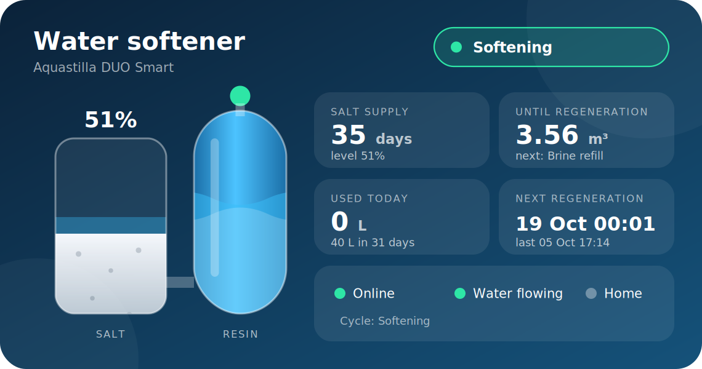
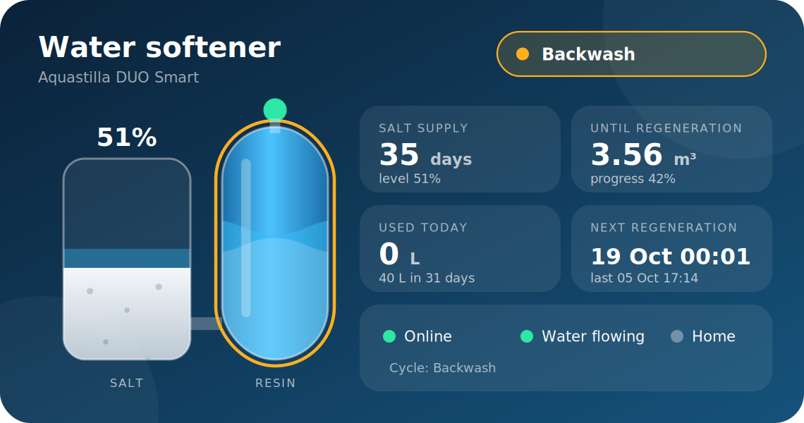
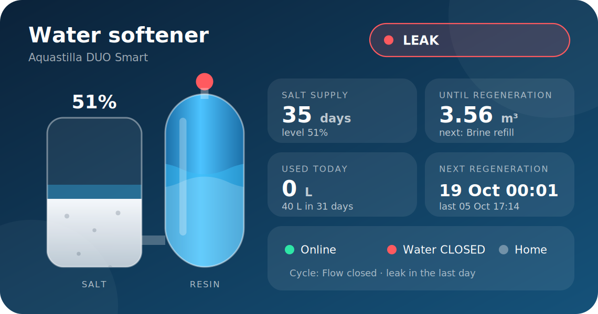

# Examples

Copy and adapt. Every file uses the entity prefix `aquastilla_duo_smart_`, which is what a device
named "Aquastilla DUO Smart" gets. If you renamed the device, replace the prefix. To find it, open
Developer tools, States, and filter on `salt_level`.

| File | What it is |
|---|---|
| [`status-card.j2`](status-card.j2) | One SVG status card for a Markdown card: salt tank, resin tank, supply, water use, next regeneration, alarms. Needs no custom frontend card |
| [`dashboard-section.yaml`](dashboard-section.yaml) | A dashboard section of tiles, with the alarms shown only while they are on |
| [`automations.yaml`](automations.yaml) | Alerts for low salt, leak, head error and a softener that stays offline |

## The status card

Add a Markdown card and paste the content of `status-card.j2` into it. The card is a single
image computed by the template, so it has no frontend dependency. During a regeneration the resin tank gets an
amber outline and the status pill turns amber. A leak, a head error or a closed water flow turns it red.

The text is in English. The cycle names are in one dictionary near the top of the template.
